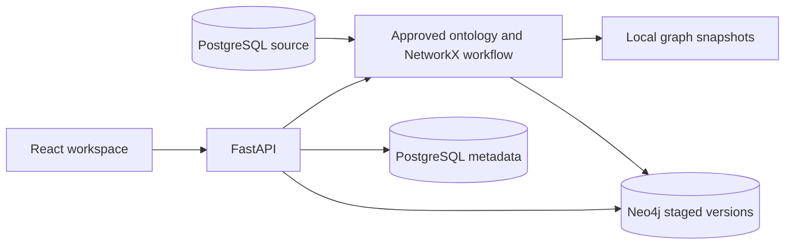

# Knowledge Graph platform audit and implementation plan

The React workspace uses React Router, Material UI, TanStack Query and Cytoscape. It has separate session and published graph views. Session graphs exist in NetworkX or filesystem snapshots. Published versions use Neo4j as graph storage and PostgreSQL as the authoritative version registry. Publication verifies counts and endpoints before changing the current pointer. Imports use version-scoped batches and a composite Neo4j node constraint. Existing local snapshots and Neo4j publications have independent lifecycles.

FastAPI verifies bearer tokens. Workflow sessions are owner-scoped. The metadata registry has users, project owners and viewers, graph builds, workspace items and audit events. Neo4j is configured with separate server-side import and read credentials. The backend compiles a bounded Cypher subset to scoped statements. Existing routes cover sessions, source discovery, ontology, builds, local graphs, published versions, schema, query, analytics, health, paths and exports. PostgreSQL migrations already create the graph registry. No new database is needed for a first bounded intelligence implementation.

| Steps | Baseline and verification |
|---|---|
| 1–9 | Source discovery, manual ontology, Groq suggestion review, validation and approved versions exist. Workflow state and ontology files remain session-owned. |
| 10–15 | Build plan, staged full reads, profiling, cleanup, entity resolution, NetworkX construction and validation exist. Previous disposable integration tests exercised these stages. |
| 16 | Local snapshots and staged Neo4j publication exist. Previous integration tests verified import, restore and failure isolation. No successful deployment publication was verified in the preceding troubleshooting. |
| 17 | Publication caches NetworkX centrality, connectivity and communities. The UI exposes those results. GDS, model evaluation and durable arbitrary algorithm jobs are missing. |
| 18 | Both graph views, bounded traversal, scoped queries and schema exist. Published GraphML export exists. GraphML upload and staging are missing. The existing Groq integration assists ontology creation only. |
| 19 | Bounded worker, cancellation, publication health and interrupted staging recovery exist. Refresh reconciles through full source reads. Scheduled refresh, CDC and durable resume remain gaps. |

Inherited risks include process-local workflows, memory use during extraction, the tracked root environment file, and legacy raw snapshot exports. Some Neo4j deployments require explicit CA configuration and independently provisioned read privileges. A shared graph adapter should operate on bounded normalized neighborhoods with host services responsible for authorization. Keep LLM sharing explicitly enabled and send minimal graph facts. Keep all generated queries behind the existing compiler and require user review before execution.

## Implementation order

1. Reuse existing published persistence and introduce bounded neighborhood analysis independent of the storage engine.
2. Add safe GraphML validation and reusable GraphML serialization. Staged import must use an owner-controlled publication path with an approved validation contract.
3. Expose deterministic structural recommendations and embeddings with a documented scoring model and sample limits.
4. Add schema-aware query drafts and graph evidence retrieval. Reuse existing scoped execution for reviewed queries. Use a provider interface for generation.
5. Expose bounded graph reads to MCP over a supported transport and keep existing API authentication and authorization in the path. Add a constrained investigation workflow.
6. Run targeted tests and document deployment and remaining requirements. Use the existing [baseline audit](KNOWLEDGE_GRAPH_IMPLEMENTATION_AUDIT.md) and [prior verification report](KNOWLEDGE_GRAPH_IMPLEMENTATION_REPORT.md) for the repository inventory and live verification history.

A standalone draft for structural analytics and AI existed from the preceding interrupted turn. At the start of this audit it was not connected to API routes or a frontend view.
