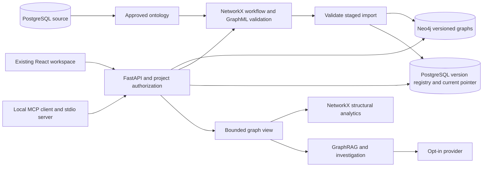

# Target architecture

Builds and imported GraphML are validated against an approved ontology. Published version topology lives in Neo4j. The PostgreSQL registry owns the current pointer, version history, project roles, saved items and audit records. The bounded graph view is the common analytics input. NetworkX supplies local views and computes rankings over either adapter's normalized view. Neo4j supplies persisted traversal and Cypher. No second source of truth or vector store was added.

The previous implementation had distinct session and published explorers. This upgrade shares the bounded intelligence calculation and GraphML encoding across both. Query drafting and answer generation currently require published versions. See the [audit](KNOWLEDGE_GRAPH_PLATFORM_AUDIT.md) and [API reference](API_REFERENCE.md) for verification and scope.
