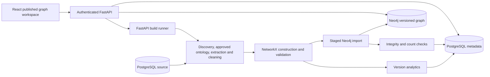

# Published graph platform

[Baseline implementation audit](KNOWLEDGE_GRAPH_IMPLEMENTATION_AUDIT.md)

## Architecture



The PostgreSQL project record owns the current pointer. Import creates a staging build, loads nodes and relationships, verifies matched endpoints and exact version counts, then updates the build and pointer in one metadata transaction. A failed, cancelled or interrupted import leaves the prior current version available. Transient Neo4j failures retry with the same staging ID and idempotent merges. Maintenance marks abandoned staging rows as failed after the worker's PostgreSQL advisory lock disappears. An owner can restore a ready version in one transaction.

Neo4j uses the `KGEntity` label and an additional ontology label for each node. Relationship types reflect the ontology. The composite `kg_entity_version_identity` uniqueness constraint backs lookup by `(projectId, graphVersionId, id)`. Relationship writes match both endpoints by the same project and version. A relationship merge uses the directed endpoints, type, and edge key within that scope. A database per graph version would require deployment capabilities that the included Community profile does not provide. [Neo4j constraint reference](https://neo4j.com/docs/cypher-manual/current/schema/constraints/create-constraints/)

## Install or upgrade

1. Apply [the base metadata schema](../database/postgres/init/02_kg_meta_schema.sql) and [the idempotent graph lifecycle migration](../database/postgres/init/04_graph_versions.sql). A fresh Docker PostgreSQL volume runs both. Apply the lifecycle migration explicitly to an existing volume.
2. Set `KG_META_DSN` to a server-side PostgreSQL metadata connection. The application identity needs the runtime data privileges on `kg_meta` tables and event identity sequence. Apply DDL separately as the schema owner. Continue using a read-only source identity for PostgreSQL extraction.
3. Set `NEO4J_URI`, `NEO4J_DATABASE`, `NEO4J_USER`, and `NEO4J_PASSWORD` for import. The importer needs token creation and graph write privileges plus schema permissions for the composite constraint creation statement.
4. Set `NEO4J_READ_USER` and `NEO4J_READ_PASSWORD` for published graph reads. In a shared deployment provision a database-scoped read role. Grant schema inspection privileges if indexes and constraints should be visible. The bundled Community edition has no restricted reader role. Use Community with isolated development data and server-owned scoped statements. [Neo4j user management](https://neo4j.com/docs/operations-manual/current/authentication-authorization/manage-users/)
5. Set a stable secret `KG_GRAPH_ID_KEY` when mapped node or edge keys contain sensitive columns. The service pseudonymizes those identifiers with HMAC and omits raw node source keys. Rotating the key changes those graph identities and affects version comparisons. Published imports omit ontology PII attributes and explicitly scoped sensitive columns.
6. Set `KG_GRAPH_RETENTION_DAYS` to the desired minimum age for deleting historical builds. The default is 30 days. The current version is protected even when the setting is zero.

The configured login remains the bootstrap account. Metadata users authenticate against bcrypt hashes in `kg_meta.app_user`. Provision usernames and supported bcrypt hashes through the metadata administration process. Project owners grant or revoke viewer access in Published Graphs. Viewers can inspect, query, export and manage their own saved scenes and queries. Publication, pointer changes, deletion and membership management require the project owner. Workflow sessions are available to their originating identity.

## Use the React workspace

1. Create a workflow, connect a source, and approve an ontology. Run the graph build and validation.
2. In **Storage & snapshots**, select **Publish to Neo4j** and queue publication. Alternatively use **Graph Operations** to reconcile the active workflow and publish in one job. Job status is pollable and supports cancellation before the publication commit.
3. Open **Published Graphs** from the sidebar. Pick a project and version. Use **Graph Versions** to compare, restore or export versions. Exports support JSON, GraphML and separate node and relationship CSVs. GraphML stores each record in a JSON data field and uses stable XML-safe endpoint IDs.
4. Use **Published Graph Explorer** to search, filter properties, expand one or two hops, inspect nodes and relationships, find bounded shortest paths, or save a scene. Published graph canvases load bounded views.
5. Use **Query Workbench** to run built-in templates or a scoped Cypher subset. Use Graph, Table and JSON result views. Queries run through the backend with a database timeout and a row cap. Saved query state and execution summaries are isolated by project, version and actor.

Supported editable Cypher matches a single labelled node or one typed directed relationship. Return declared variables or counts, with an optional limit. The backend compiles this grammar to scoped parameterized statements.

```cypher
MATCH (customer:Customer)-[relationship:PLACED]->(order:Order)
RETURN customer, relationship, order
LIMIT 100
```

**Graph Analytics** uses publication-time results. Connectivity and degree metrics run on all published graphs. PageRank, sampled betweenness, closeness and Louvain run up to 2,000 nodes and 20,000 relationships. Mean shortest-path length is calculated for a connected projection with at most 500 nodes. **Graph Schema** shows scoped labels, relationship directions, properties and counts and queries the application's Neo4j schema objects.

## Verification

The opt-in [live API test](../backend/tests/test_graph_live.py) uses the repository's seeded retail schema on disposable loopback PostgreSQL and a separate Neo4j fixture. It exercises connection, discovery, schema-derived ontology approval, extraction, cleaning, NetworkX validation, publication, Neo4j search, two-hop expansion, shortest paths, scoped Cypher, analytics, schema, exports, saved scenes, query history, project roles, reconciliation, version comparison, restore and retention. It injects failure after real Neo4j writes and confirms the failed version stays inaccessible while the original remains current.

The [browser test](../frontend/e2e/published-graphs.spec.ts) opens a published fixture in the real React application and verifies entity expansion and the Cypher graph result. The [React component tests](../frontend/src/test/published-graphs.test.tsx) cover scoped calls and viewer controls. See the implementation report for results and limitations.

For a repeatable live test, apply the source fixture and both metadata schemas to disposable PostgreSQL, and start a disposable Neo4j database. Set the normal server database environment. Set `KG_TEST_SOURCE` to the disposable read-source connection object before invoking the live pytest file. The live test inserts and deletes its own order and order item to exercise reconciliation. The browser test uses an already-published fixture and the `KG_TEST_BROWSER_USER` and `KG_TEST_BROWSER_PASSWORD` environment variables. Test ports, Python executable and browser channel can be overridden in the Playwright configuration.

## Remaining limitations

- Source refresh runs full reconciliation. Source CDC, a durable job queue with automatic resume, schedules and failure notifications remain open. Process-local workflow sessions still contain source connection state and approved ontology files.
- Version metadata and graph ownership are durable. New workflow sessions create new projects. Editing or rebuilding a durable project after its originating workflow expires requires further workflow reattachment and a durable source credential reference.
- The Cypher editor supports a constrained grammar. Broader Cypher would need a deployment-specific database authorization model and a scope-safe query design. Query cancellation, per-user throttling and an advanced editor are pending.
- The graph materializes in NetworkX during construction. Comparative load tests for large source tables and database resource telemetry are pending. Historical local snapshot artifacts follow the legacy filesystem path and retain their original content.
- The disposable live suite uses Neo4j Community. It verifies application authorization and query scoping. Production Neo4j reader privileges and production deployment connectivity require verification on the target installation.
